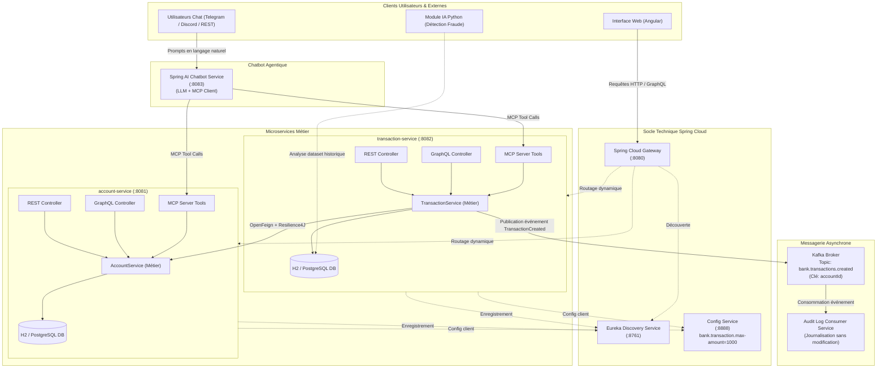

# Partie B — Conception et Architecture

Ce document contient le diagramme de classes et le schéma d'architecture globale demandés dans la **Partie B** du sujet d'épreuve technique ENSET / ADRIA.

---

## 1. Diagramme de Classes Métier et Séparation des Couches

Conformément au sujet, les microservices respectent une architecture en couches stricte :
- `domain/` : Entités et Enums
- `repository/` : Interfaces Spring Data JPA
- `service/` : Couche métier unifiée encapsulant les règles bancaires
- `web/rest/`, `web/graphql/`, `mcp/` : Connecteurs exposant les mêmes méthodes du service

```mermaid
classDiagram
    direction TB

    namespace AccountService_Domain {
        class AccountStatus {
            <<enumeration>>
            ACTIVE
            BLOCKED
        }
        class Account {
            +UUID id
            +String customerReference
            +AccountStatus status
            +String currency
            +double balance
            +debit(double amount) void
            +credit(double amount) void
        }
    }

    namespace AccountService_Layers {
        class AccountRepository {
            <<interface>>
            +findById(UUID id) Optional~Account~
            +save(Account account) Account
            +findAll() List~Account~
        }
        class AccountService {
            <<interface>>
            +getAccount(UUID id) Account
            +getAllAccounts() List~Account~
            +createAccount(Account account) Account
            +updateBalance(UUID id, double newBalance) Account
            +debitAccount(UUID id, double amount) Account
            +creditAccount(UUID id, double amount) Account
        }
        class AccountRestController {
            -AccountService accountService
            +getAccount(UUID id) ResponseEntity
            +createAccount(Account account) ResponseEntity
            +updateBalance(UUID id, double amount) ResponseEntity
        }
        class AccountGraphQLController {
            -AccountService accountService
            +accountById(UUID id) Account
            +accounts() List~Account~
            +createAccount(...) Account
        }
        class AccountMcpTools {
            -AccountService accountService
            +getAccountBalance(UUID id) String
            +checkAccountStatus(UUID id) String
        }
    }

    Account --> AccountStatus
    AccountRepository ..> Account
    AccountService --> AccountRepository
    AccountRestController --> AccountService
    AccountGraphQLController --> AccountService
    AccountMcpTools --> AccountService

    namespace TransactionService_Domain {
        class Transaction {
            +UUID id
            +UUID accountId
            +BigDecimal amount
            +String currency
            +String merchantCategory
            +String country
            +Instant createdAt
        }
        class TransferRequest {
            +UUID sourceAccountId
            +UUID targetAccountId
            +BigDecimal amount
            +String currency
        }
    }

    namespace TransactionService_Layers {
        class TransactionRepository {
            <<interface>>
            +findById(UUID id) Optional~Transaction~
            +findByAccountId(UUID accountId) List~Transaction~
            +save(Transaction transaction) Transaction
        }
        class AccountRestClient {
            <<interface - FeignClient>>
            +getAccount(UUID id) AccountDTO
            +updateBalance(UUID id, double amount) AccountDTO
        }
        class TransactionEventProducer {
            -KafkaTemplate kafkaTemplate
            +publishTransactionCreated(TransactionCreatedEvent event) void
        }
        class TransactionService {
            <<interface>>
            +createTransaction(Transaction tx) Transaction
            +getTransactionsByAccount(UUID accountId) List~Transaction~
            +transfer(TransferRequest request) void
        }
        class TransactionRestController {
            -TransactionService transactionService
            +create(Transaction tx) ResponseEntity
            +getByAccount(UUID accountId) ResponseEntity
            +transfer(TransferRequest req) ResponseEntity
        }
        class TransactionGraphQLController {
            -TransactionService transactionService
            +transactionsByAccount(UUID accountId) List~Transaction~
            +executeTransfer(...) Boolean
        }
        class TransactionMcpTools {
            -TransactionService transactionService
            +executeTransfer(UUID from, UUID to, BigDecimal amount) String
            +listRecentTransactions(UUID accountId) String
        }
    }

    TransactionRepository ..> Transaction
    TransactionService --> TransactionRepository
    TransactionService --> AccountRestClient : Feign + Resilience4J
    TransactionService --> TransactionEventProducer : Kafka
    TransactionRestController --> TransactionService
    TransactionGraphQLController --> TransactionService
    TransactionMcpTools --> TransactionService
```

---

## 2. Schéma d'Architecture Cible

Le schéma suivant décrit l'écosystème global des composants techniques et fonctionnels :
- **Composants techniques** : Spring Cloud Gateway, Eureka Discovery Service, Spring Cloud Config Service, Apache Kafka.
- **Microservices métier** : `account-service` et `transaction-service` (connecteurs REST, GraphQL, MCP).
- **Communication inter-services** : OpenFeign avec disjoncteur Resilience4J.
- **Événements asynchrones** : Publication sur Kafka (`bank.transactions.created`).
- **Composant IA / Agentique** : Chatbot Spring AI exploitant les Model Context Protocol (MCP) Tools.
- **Clients** : Interface Web Angular, clients Telegram / Discord, script d'analyse de fraude Python.

